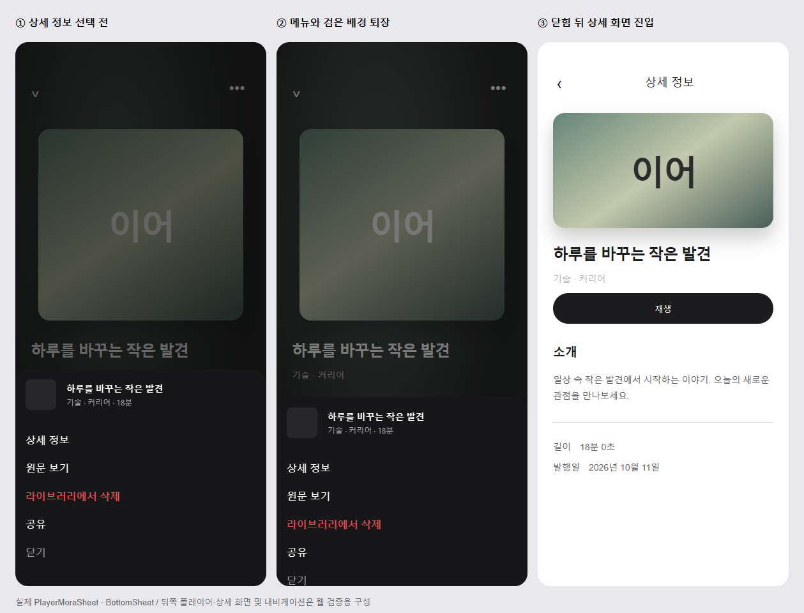

# 플레이어에서 상세 화면으로 이동하는 순서

| 항목      | 값                                                              |
| --------- | --------------------------------------------------------------- |
| 발행 날짜 | 2026-10-11                                                      |
| 요청      | 플레이어를 연 뒤 상세정보를 열 때 검은 배경 전환이 부자연스러움 |
| 반영 날짜 | 2026-10-14 |

앞선 `sheet-backdrop-presentation.md`는 더보기 메뉴가 나타나는 순간의 준비 순서를 다뤘다. 이 변경은 PL7 [상세 정보]를 눌러 실제 콘텐츠 상세 화면으로 이동하는 구간을 다룬다.

`openDetail`은 메뉴를 닫는 상태 변경과 상세 화면 내비게이션을 동시에 실행했다. 메뉴의 딤·패널 퇴장과 상세 화면 전환이 겹치므로, 메뉴를 완전히 닫은 뒤 내비게이션을 실행한다(`content-detail.md` 2장, `design.md` 4장).

- iOS는 기존 `Modal.onDismiss` 완료를 기다린다.
- Android는 공용 시트의 퇴장 완료 및 숨김 커밋 뒤 콜백을 받는다. iOS 전용 공유 완료 콜백의 계약은 유지한다.
- 보류된 상세 이동은 한 번만 실행한다. 플레이어를 떠나거나 콘텐츠가 바뀌면 취소한다. 재생·뒤로가기 목적지·공유 동작은 유지한다.

## 완료 조건

- Given 플레이어 더보기 메뉴, When [상세 정보]를 누르면, Then 메뉴가 닫히는 동안 상세 화면을 열지 않고 닫힘 완료 뒤 한 번만 이동한다.
- Given 보류 중인 상세 이동, When 플레이어를 떠나거나 콘텐츠가 바뀌면, Then 늦게 닫힘 콜백이 와도 이동하지 않는다.
- Given 일반 메뉴 닫기 또는 공유, When 닫힘이 끝나면, Then 상세 화면을 열지 않고 기존 공유 후속 동작을 유지한다.
- Given Android 시트 퇴장, When 애니메이션이 끝나면, Then 모달 숨김 커밋 뒤 후속 콜백을 한 번 호출한다. 취소된 모션에는 호출하지 않는다.

## 검증

- 실제 `usePlayerScreen` 및 공용 `BottomSheet` 테스트 12건 통과: 닫힘 완료 전 이동 없음, 중복 이동 방지, 일반 닫기·공유 유지, 이탈·콘텐츠 변경 시 취소, 숨김 콜백 순서.
- TypeScript·변경 코드 ESLint·Prettier 통과.
- 실제 `PlayerMoreSheet` 웹 미리보기에서 [상세 정보] 탭 → 246ms 뒤 메뉴 숨김 → 상세 표시 순서를 확인했다. 퇴장 중 상세 표시 없음, 런타임 오류 없음.
- 미리보기의 뒤쪽 플레이어·상세 화면·내비게이션은 검증용 구성이다. iOS 네이티브 화면 전환의 최종 체감은 기기 확인이 필요하다.
- JS 변경으로 OTA 적용 가능하며 새 네이티브 빌드는 필요하지 않다.

## 처리 기록

- 2026-10-14 반영 — `spec/uiux/player-uiux.md` 4.7 PL7 [상세 정보] — 메뉴 닫힘 완료 뒤 한 번만 이동(iOS onDismiss · Android 퇴장 완료+숨김 커밋), 이탈·콘텐츠 변경 시 취소, 일반 닫기·공유 유지 · `frontend/design.md` 5장 시트 절(Android 닫힘 콜백 순서).
