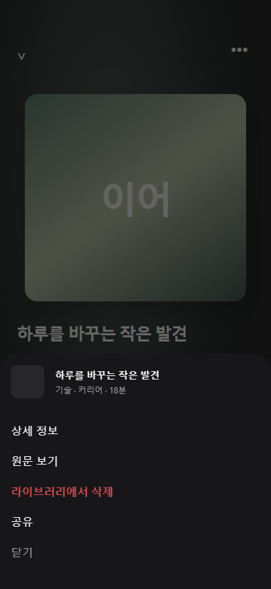

# 플레이어 상세정보 메뉴 배경의 시작 프레임 보장

| 항목      | 값                                                                      |
| --------- | ----------------------------------------------------------------------- |
| 발행 날짜 | 2026-10-11                                                              |
| 요청      | 플레이어 상세정보 메뉴가 뜰 때 검은 배경의 부자연스러운 애니메이션 개선 |
| 반영 날짜 | 2026-10-14 |

공용 `BottomSheet`는 위치와 딤을 같은 진행값으로 움직이지만, 네이티브 모달 표시 완료 전에 스프링을 시작했다. 특히 다시 열 때는 높이가 남아 있어 표시 준비를 기다리지 않는다. 네이티브 준비가 늦으면 투명한 시작 구간이 보이지 않고 이미 어두워진 배경부터 표시될 수 있다.

- `design.md` 4장 모션의 같은 진행값·네이티브 드라이버 원칙을 유지한다.
- 모달의 `onShow`와 시트 높이 측정이 모두 끝난 뒤 열림을 시작한다. 준비 전에는 시트는 화면 밖, 딤은 투명하다.
- 닫힌 뒤 표시 준비 상태를 초기화한다. 전환 중 반대 조작이나 언마운트 시 이전 애니메이션을 중단한다.
- 드래그 속도를 이어받되 위치와 딤 보간을 0~1에 제한한다. 상세 이동·공유·재생 동작과 최종 색·높이는 유지한다.

## 완료 조건

- Given 모달 표시가 늦거나 높이가 아직 없는 상태, When 메뉴를 열면, Then 준비 전에는 애니메이션이 진행하지 않고 두 조건이 충족되면 함께 시작한다.
- Given 한 번 닫은 메뉴, When 다시 열면, Then 이전 높이가 있어도 새 모달의 표시 완료를 기다린다.
- Given 열림·닫힘 중 반대 조작, When 진행 중 애니메이션이 취소되면, Then 이전 완료 콜백이 새 메뉴를 숨기지 않는다.
- Given 메뉴를 아래로 끄는 상태, When 움직이거나 놓으면, Then 시트와 딤은 같은 진행값을 따르고 나가는 모션이 끝난 뒤 모달이 숨겨진다.

## 검증

- 네이티브 표시 이벤트를 지연시킨 컴포넌트 테스트 6건 통과: 표시·높이 순서 양쪽, 재열기, 닫힘 취소, 표시 전 닫기, 위치·딤 보간 범위.
- 실제 `PlayerMoreSheet` 웹 미리보기에서 49프레임 확인: 시작 딤 0 / 이동 340px → 138ms 딤 0.538 / 이동 157px → 788ms 딤 1 / 이동 0px. 재열기·닫기 성공, 런타임 오류 없음.
- TypeScript·변경 파일 ESLint·Prettier 통과.

미리보기의 메뉴는 실제 컴포넌트이며 뒤쪽 플레이어는 검증용 구성이다. 웹은 네이티브 모달 표시 지연을 재현하지 않으므로 iOS·Android의 최종 체감은 기기 확인이 필요하다. JS 변경으로 OTA 대상이며 새 네이티브 빌드는 필요하지 않다.

## 처리 기록

- 2026-10-14 반영 — `frontend/design.md` 5장 "시트·다이얼로그" — 공용 BottomSheet 열림 시작 프레임 보장(onShow + 높이 측정 뒤 시작, 준비 전 시트 화면 밖·딤 투명, 재열기 대기, 반대 조작·언마운트 시 이전 애니메이션 중단, 위치·딤 보간 0~1 제한) 문단 추가.
