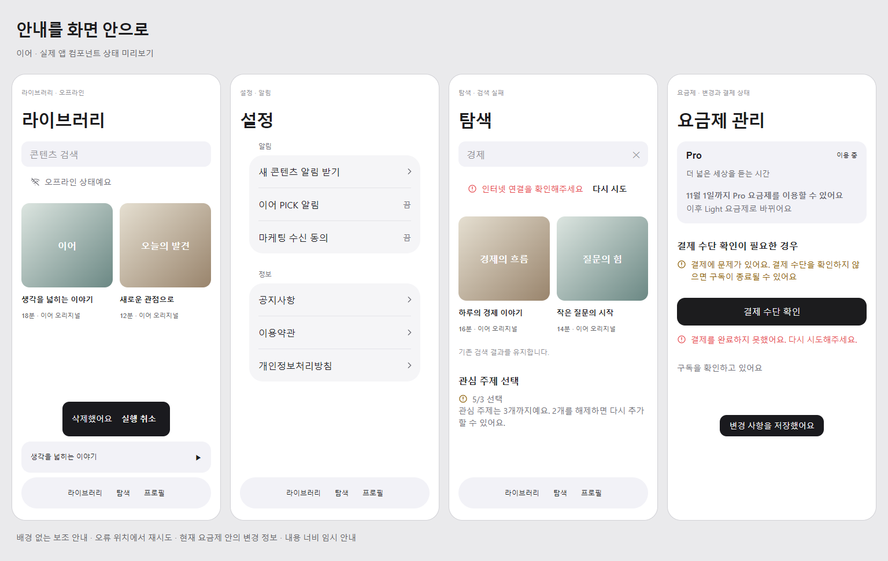

# 안내 띠를 화면 안의 상태 안내로 통합

| 항목 | 값 |
|---|---|
| 발행 날짜 | 2026-10-11 |
| 요청 | 사용자 제안 승인: “일단 ㄱㄱ” |

기존 `design.md` 및 화면 명세의 배경 있는 배너 표현을 아래 기준으로 변경한다. 서버 판정·노출 조건·알림 권한·결제 동작·자동 소멸 시간은 유지한다. 특히 요금제 변경 예약의 검정 알림 박스 규칙을 대체한다.

- 라이브러리 오프라인: 배경 없는 Wi-Fi 아이콘과 보조 문구.
- 설정 알림 유도: 알림 섹션의 일반 메뉴 행 “새 콘텐츠 알림 받기”. 사전 안내 모달 제목은 유지.
- 탐색 검색 실패: 검색창 아래 짧은 오류 문구와 44pt 이상 재시도 버튼. 기존 결과 유지.
- 플레이어 네트워크 중단: 재생 컨트롤 자리에 네트워크 안내와 재시도. 버퍼로 재생 중인 경우 컨트롤 유지. 자동 재생 복구 정책은 유지.
- 관심 주제 초과: 선택 개수 옆 경고 아이콘, 아래 해제할 개수 안내. 실제 개수 유지.
- 구독 변경 예약: 현재 요금제 정보 아래 날짜와 변경 내용. 결제 문제·처리 결과는 배경 없는 인라인 안내와 의미색 아이콘.
- 토스트·실행취소: 내용 너비의 연속 곡률 사각형. 실행취소 5초·토스트 3초 및 액션 유지. 하단 독 위에 배치.

## 완료 조건

- Given 오프라인·알림 미결정·관심 주제 초과 상태, When 각 화면을 열면, Then 독립 배경 띠 없이 해당 제목·목록·선택 개수에 안내가 붙는다.
- Given 검색 결과가 남아 있는 조회 실패, When 다시 시도를 누르면, Then 기존 결과를 지우지 않고 같은 검색을 재조회한다.
- Given 네트워크 안내 상태, When 버퍼 재생이 이어지면, Then 컨트롤을 유지하고, 멈추거나 버퍼링되면 같은 자리에 안내와 재시도를 표시한다.
- Given 구독 변경 예약·결제 문제, When 요금제를 열면, Then 이용 중 요금제와 함께 안내가 읽히고 기존 결제 관리 동작이 유지된다.
- Given 삭제·토스트, When 표시되면, Then 내용 너비로 표시되고 44pt 액션과 기존 소멸 시간이 유지된다.

## 시각 확인

실제 컴포넌트로 만든 상태별 미리보기(주변 화면은 웹 검증용 구성):

## 검증

- TypeScript, 변경 파일 ESLint·Prettier 확인.
- 관련 6개 테스트 파일 28건: 검색 재시도·기존 결과 유지, 해지 예약 정보 보존, 결제 피드백, 네트워크 수동 재생 시 위치·음원 유지, 안내 호스트 해제 순서.
- 실제 안내·설정 행·구독 정보·스낵바의 웹 미리보기: 액션 동작, 재시도·실행취소 터치 영역 44pt, 320/393px 가로 넘침 없음.
- iOS 시스템 탭 높이는 JS 탭 높이 컨텍스트가 없어 기존 RNSSafeAreaView의 UIKit 안전영역 실측을 사용한다. 실기기에서 탭·미니플레이어 유무별 최종 배치를 확인해야 한다.
- JS 변경으로 개발계 OTA 대상. 새 네이티브 빌드는 필요하지 않다.
